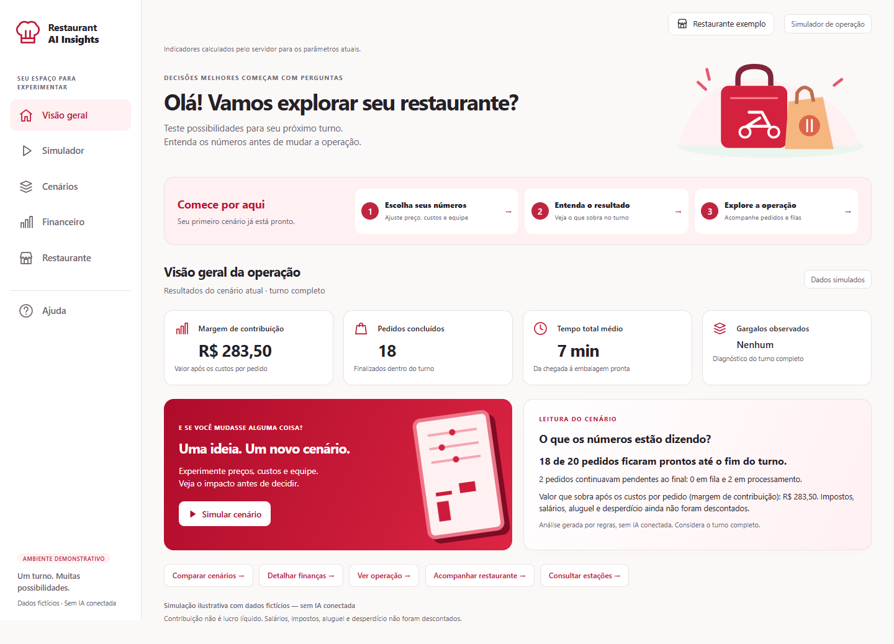
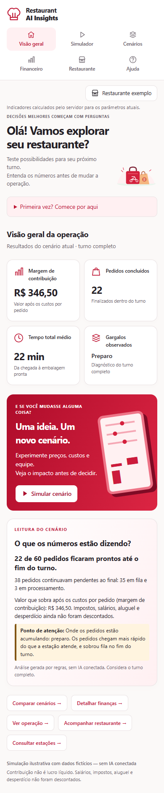
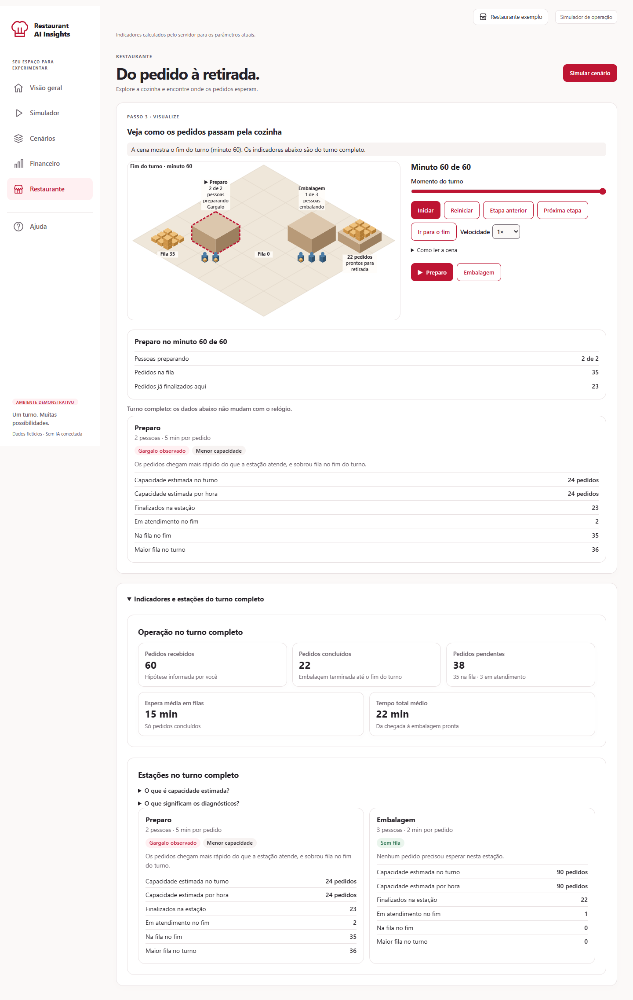

# Restaurant AI Insights

Simulador local para explorar como preço, desconto, custos, quantidade de pedidos e equipe afetam
um turno de restaurante. Foi pensado para quem gerencia um pequeno restaurante e tem pouca
familiaridade com software.

> Simulação ilustrativa com dados fictícios. **Não há modelo de IA integrado:** o projeto foi
> desenvolvido com assistência de IA, mas funciona só com regras e cálculos. Não usa serviços pagos,
> chaves de API nem recursos externos para executar.



A interface está organizada em **Visão geral, Simulador, Cenários, Financeiro, Restaurante e Ajuda**.
Os indicadores principais aparecem no dashboard. Os detalhes ficam nas áreas correspondentes,
preservando os valores ao navegar. No celular, o guia inicial fica recolhido.

## Dashboard e navegação

| Área | O que você pode fazer |
| --- | --- |
| **Visão geral** | Consultar margem de contribuição em reais, pedidos concluídos, tempo total médio, gargalos e resumo do turno |
| **Simulador** | Ajustar preço e demanda, custos por pedido e equipe/tempos; aplicar três exemplos fictícios |
| **Cenários** | Guardar, substituir ou limpar o cenário A e comparar parâmetros e resultados com o cenário atual |
| **Financeiro** | Detalhar contribuição, receita atendida, preço líquido, taxa do canal e limites do cálculo |
| **Restaurante** | Reproduzir o turno, selecionar estações e abrir os indicadores operacionais e os dados de filas |
| **Ajuda** | Consultar fórmulas, hipóteses, capacidade e significado dos gargalos |

A navegação preserva o formulário e o cenário A, aceita links diretos e acompanha o histórico do
navegador. Ao sair de **Restaurante**, a reprodução pausa. Ao recarregar a página, o cenário A e
as alterações no formulário são descartados.

O layout se adapta a desktop, tablet e celular, com temas claro e escuro conforme a preferência
do sistema. No celular, os seis destinos ficam visíveis no menu e o guia pode ser expandido.

<details>
<summary>Ver a interface no celular</summary>



</details>

## Como funciona

1. **Comece pela Visão geral.** Um cenário inicial é calculado ao abrir a aplicação, sem precisar
   preencher os campos. Os indicadores e o resumo descrevem o turno completo.
2. **Abra Simulador.** Ajuste os grupos de preço/demanda, custos e equipe/tempos, ou aplique um dos
   exemplos fictícios. A quantidade de pedidos é uma hipótese sua: o simulador não a estima,
   e o desconto não a altera.
3. **Use Simular cenário para voltar ao dashboard.** O botão recalcula e abre a Visão geral.
   Editar um campo também atualiza os resultados automaticamente, sem trocar de área ou mover o foco.
4. **Compare em Cenários.** Guarde o resultado atual como A, altere os valores em Simulador e volte
   a Cenários para conferir as diferenças. Substituir e limpar A são ações explícitas; o sistema
   não escolhe um cenário vencedor.
5. **Acompanhe os pedidos em Restaurante.** O Canvas isométrico reproduz os eventos do servidor,
   com relógio, velocidade e etapas. Selecione uma estação por clique ou pelos botões de teclado.
   A cena mostra o momento escolhido; os indicadores operacionais continuam sendo do turno completo.

Durante o cálculo, a interface informa o carregamento. Campos inválidos recebem mensagens próprias;
em falhas de conexão ou do servidor, **Tentar novamente** permite recuperar sem apagar os valores.
Se já houver um resultado, ele é identificado como o último cenário válido. Comparação sem cenário A,
zero pedidos e contribuição negativa têm mensagens específicas.



## Como executar

Ambiente verificado: **Windows e Python 3.15**. A interface usa HTML, CSS, JavaScript e Canvas nativos;
não exige Node.js, npm, etapa de build, banco de dados, autenticação ou serviços externos para executar.

Depois de clonar o repositório e entrar na pasta, execute no PowerShell:

```powershell
python -m venv .venv
.\.venv\Scripts\python.exe -m pip install -r requirements.txt
.\.venv\Scripts\python.exe -m uvicorn src.simulador.api:app --port 8010
```

Abra <http://127.0.0.1:8010>. Se a porta estiver ocupada, escolha outro número. Para recarregar o
servidor ao editar o código, acrescente `--reload`. O roteiro em
[`docs/demonstracao.md`](docs/demonstracao.md) mostra a aplicação em cerca de 5 minutos.

## Testes e validação

Para os testes Python, use o ambiente virtual acima. Os testes JavaScript foram verificados com
**Node.js 24** e usam o executor nativo, sem instalar pacotes npm:

```powershell
.\.venv\Scripts\python.exe -m pytest
node --test "tests/js/*.test.mjs"
```

O segundo comando testa a lógica do JavaScript. Ele usa só o Node.js, sem pacotes npm, e não é
necessário para executar o simulador.

Na validação da RAI-007, o código do commit `685dc6f` passou em clone limpo, com ambiente virtual
próprio e dependências reinstaladas:

| Verificação | Resultado registrado |
| --- | --- |
| Python / pytest | 176 testes aprovados |
| JavaScript / Node.js | 97 testes aprovados |
| Dependências / `pip check` | Sem erros |
| Chrome instalado, sem janela, com Playwright e axe | 72 combinações: seis áreas × seis larguras × dois temas, sem estouro horizontal ou violações detectadas pelo axe |

As larguras verificadas foram 320, 390, 768, 1024, 1440 e 1920 px. Os fluxos cobrem simulação,
preservação dos campos, comparação, validação, contribuição negativa, zero pedidos, exemplos,
gargalos, reprodução, seleção, histórico, teclado e recuperação de falhas.

O teste opcional de navegador exige Chrome e ferramentas de desenvolvimento instaladas separadamente.
Os comandos, as versões e a opção de executar apenas os fluxos estão em
[`docs/revisao-rai-007.md`](docs/revisao-rai-007.md). O script é
[`tests/browser/interface.cjs`](tests/browser/interface.cjs); capturas temporárias ficam em `tmp/`.
Esses resultados são verificações técnicas, não validação com usuários nem garantia de acessibilidade completa.

## API

Com o servidor em execução:

- `GET /api/campos`: parâmetros, unidades, limites e valores iniciais.
- `GET /api/exemplos`: exemplos fictícios, com todos os parâmetros.
- `POST /api/simulacoes`: recebe os parâmetros e devolve `financeiro`, `operacao`, com os eventos do
  turno, e `resumo`. Valores monetários vêm em centavos inteiros.
- Entrada inválida recebe o código 422 e `{"erros": {"campo": "mensagem"}}`. Um corpo que não pode
  ser lido usa `corpo` como nome do campo.

```powershell
Invoke-RestMethod http://127.0.0.1:8010/api/campos
```

## Limitações

- **Facilidade de uso:** ainda não validada com usuários. O roteiro do teste está em
  [`docs/teste-de-uso.md`](docs/teste-de-uso.md).
- **Modelo:** um único produto, chegadas em intervalos iguais e tempos constantes, sem pausas,
  cancelamentos ou desistências.
- **Finanças:** o valor que sobra (margem de contribuição) não é lucro líquido. Impostos, salários,
  aluguel e desperdício ficam de fora, assim como os custos de pedidos ainda em processo no fim do
  turno.
- **Resultados:** descrevem este modelo. Não são previsão, recomendação nem benefício medido.
- **Cenário A:** fica só na memória da página, e recarregar o descarta.
- **Reprodução:** os itens mudam de lugar no instante de cada evento, sem deslizar.
- **Verificação:** feita no Windows, com Python 3.15 e Chrome. Os detalhes estão em
  [`docs/progress.md`](docs/progress.md).
- **Acessibilidade e aparelhos:** leitor de tela, aparelho físico, toque, zoom real e outros
  navegadores permanecem pendentes. A preferência por menos movimento foi emulada na matriz de testes.

## Organização

| Caminho | Função |
| --- | --- |
| `src/simulador/parametros.py` | Limites, valores iniciais, validação e exemplos |
| `src/simulador/operacao.py` | Filas, capacidade, diagnóstico e eventos |
| `src/simulador/financeiro.py` | Cálculos em centavos |
| `src/simulador/resumo.py` | Resumo do turno, gerado por regras |
| `src/simulador/simulacao.py` | Executa operação, finanças e resumo em sequência |
| `src/simulador/api.py` | Rotas e entrega da interface |
| `src/simulador/web/` | Interface em HTML, CSS e JavaScript puro |
| `src/simulador/web/experiencia.css` | Componentes e layout do dashboard, temas e responsividade |
| `src/simulador/web/js/navegacao.js` | Seis áreas, âncoras, histórico, foco e área ativa |
| `tests/` e `tests/js/` | Testes Python e JavaScript |
| `tests/browser/` | Verificação opcional dos fluxos e da acessibilidade no Chrome |
| `pytest.ini` | Coleta restrita a `tests/`, sem incluir clones temporários |
| `docs/` | Produto, backlog, arquitetura, progresso, demonstração e teste de uso |

O módulo de análise de avaliações fica na branch `feature/analise-avaliacoes` e não faz parte do
simulador.
