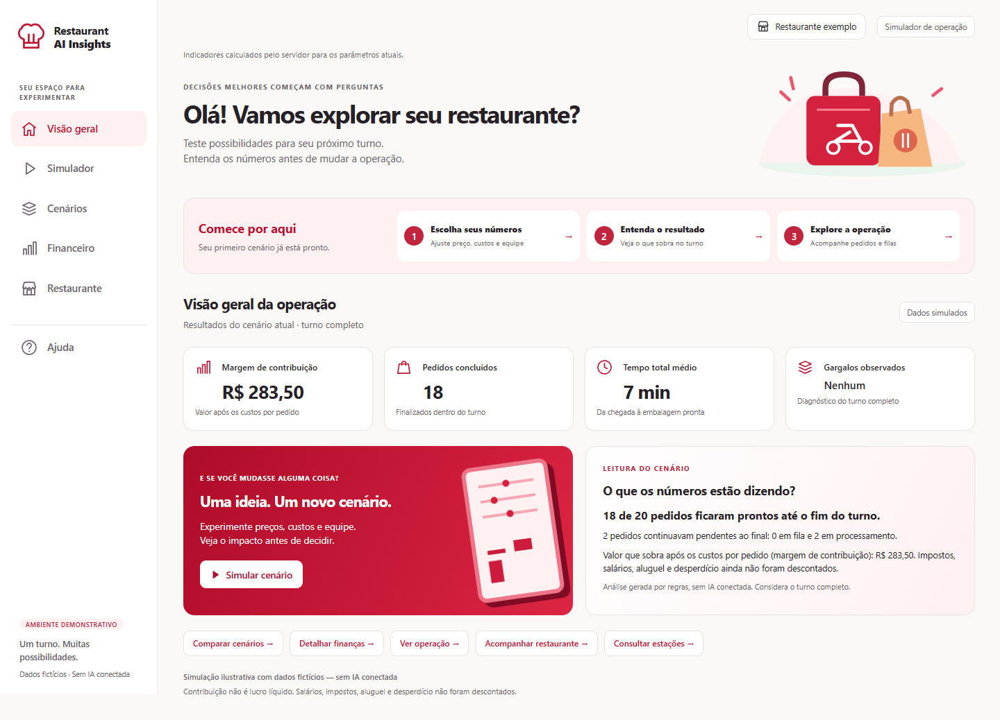
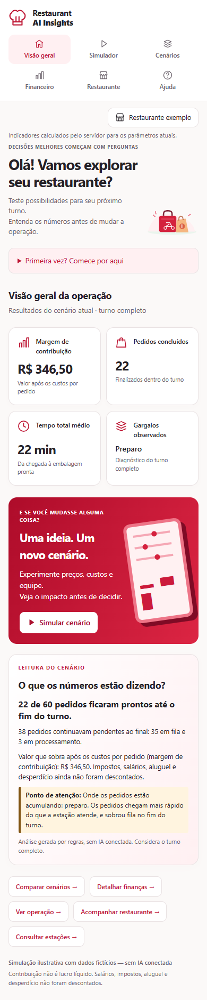
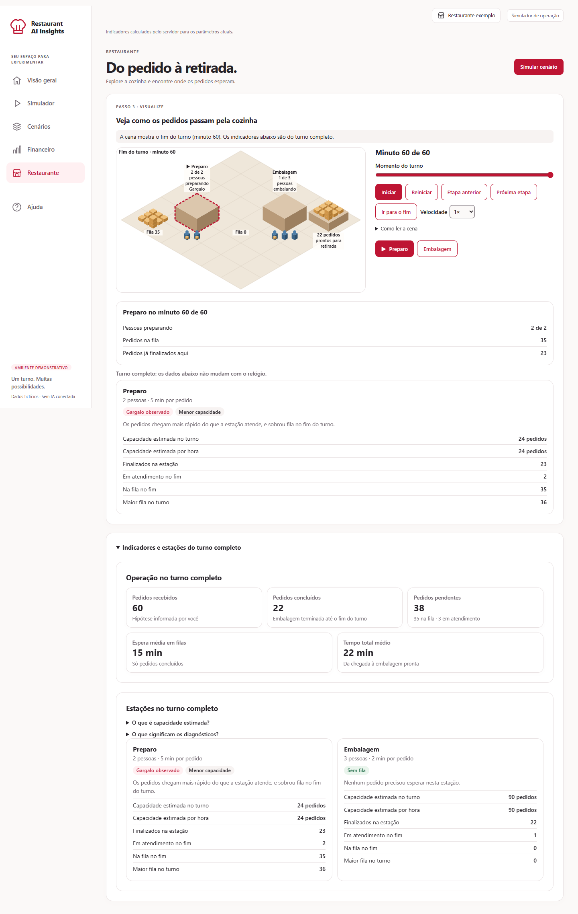

# Restaurant AI Insights

**Um desconto de R$ 5 se paga?** No exemplo, seriam necessários **25 pedidos concluídos** para preservar
a contribuição do turno. A equipe consegue concluir no máximo **22** nas condições simuladas.

[**Ver a demonstração em 24 segundos (MP4)**](docs/capturas/demo-promocao.mp4) ·
[Como executar](#como-executar) · [Avaliação da IA local](docs/explicacoes-ia.md)

O simulador explora como preço, desconto, custos, volume e equipe afetam um turno de restaurante.
O Python calcula a operação e as finanças usando dados fictícios. A explicação com IA local é opcional
e usa Ollama. A execução padrão funciona com regras e dispensa chaves, APIs pagas e modelo instalado.



A interface está organizada em **Visão geral, Simulador, Cenários, Financeiro, Restaurante e Ajuda**.
Os indicadores principais aparecem no dashboard. Os detalhes ficam nas áreas correspondentes,
preservando os valores ao navegar. No celular, o guia inicial fica recolhido.

## Dashboard e navegação

| Área | O que você pode fazer |
| --- | --- |
| **Visão geral** | Consultar margem de contribuição em reais, pedidos concluídos, tempo total médio, gargalos e resumo do turno |
| **Simulador** | Ajustar preço, demanda, custos e equipe, calcular uma ficha técnica e aplicar exemplos fictícios |
| **Cenários** | Analisar promoções, comparar alternativas, consultar dados de referência e guardar cenários em arquivo |
| **Financeiro** | Detalhar contribuição, receita atendida, preço líquido, taxa do canal e limites do cálculo |
| **Restaurante** | Reproduzir o turno, selecionar estações e abrir os indicadores operacionais e os dados de filas |
| **Ajuda** | Consultar fórmulas, hipóteses, capacidade e significado dos gargalos |

A navegação preserva o formulário e o cenário A, aceita links diretos e acompanha o histórico do
navegador. Ao sair de **Restaurante**, a reprodução pausa. Ao recarregar a página, o cenário A e
as alterações no formulário são descartados da sessão. Use **Guardar e compartilhar cenário**
para conservar uma análise em arquivo.

O layout se adapta a desktop, tablet e celular, com temas claro e escuro conforme a preferência
do sistema. No celular, os seis destinos ficam visíveis no menu e o guia pode ser expandido.

<details>
<summary>Ver a interface no celular</summary>



</details>

## Promoções e descontos — RAI-008

Na **Visão geral**, clique em **Testar uma promoção** para analisar o exemplo fictício de R$ 5 de desconto.
Em **Cenários**, escolha **Testar minha promoção** para usar seu cenário atual como referência, ou uma
referência já guardada. Abra **Editar hipótese** para ajustar o desconto, volume e equipe.
A análise mostra preço, taxa, custos, contribuição unitária/total e diferenças absolutas e percentuais.
Informa quantos pedidos **concluídos**, e quantos adicionais sobre a base, compensariam a mudança.
O desconto máximo usa as conclusões da hipótese informada. É possível ajustar a equipe diretamente
no painel, com aviso de que o custo adicional de pessoal fica fora da contribuição. As hipóteses
locais não alteram o simulador nem o A.

A meta financeira é confrontada com o limite operacional. Margem zero ou negativa, base negativa,
zero pedidos e metas fora dos limites têm explicações específicas. O desconto não prevê aumento de vendas.

Exemplo padrão: R$ 5 de desconto reduz a contribuição por pedido em R$ 4,25. Seriam necessárias
25 conclusões para compensar a base, mas a operação conclui no máximo 22 no turno dentro do limite
de volume. Mais pedidos recebidos, sozinhos, não resolvem essa limitação.

Fórmulas, casos-limite, contrato e testes: [`docs/promocoes.md`](docs/promocoes.md).

### Alternativas e dados de referência

- Em **Ver detalhes e alternativas**, compare desconto menor com reforço de equipe, custos por
  canal ou chegadas distribuídas com pico de pedidos. Na comparação por canal, consulte guias
  do iFood e da 99Food e informe as condições comerciais da loja.
- Em **Consultar pedidos de referência**, carregue o exemplo fictício ou importe um CSV no formato
  do projeto. O painel mostra pedidos concluídos e cancelados por hora de criação.
- Em **Guardar e compartilhar cenário**, baixe um JSON para reabrir a referência, a hipótese, a ficha
  técnica e as comparações já calculadas. Use **Exportar resumo** para compartilhar resultados e
  custos em texto. Reabrir recalcula os resultados para consulta e mantém a hipótese em edição.

## Ficha técnica de um produto — RAI-009

No **Simulador**, abra **Calcular ingredientes por ficha técnica** junto ao campo de ingredientes.
Você pode preencher um ingrediente de exemplo e editar seus valores. Informe o preço e a quantidade
comprada, a quantidade usada por porção e a data do preço. Use g/kg, mL/L ou unidades compatíveis.
Por exemplo, uma porção de 150 g de um ingrediente comprado a R$ 20/kg custa R$ 3,00.
**Usar custo no simulador** preenche o custo por pedido e atualiza o cenário. O campo também aceita
entrada manual. A ficha calculada também pode acompanhar o arquivo do cenário.

## Como funciona

1. **Comece pela Visão geral.** Um cenário inicial é calculado ao abrir a aplicação, sem precisar
   preencher os campos. Os indicadores e o resumo descrevem o turno completo.
2. **Abra Simulador.** Ajuste os grupos de preço/demanda, custos e equipe/tempos, ou aplique um dos
   exemplos fictícios. A quantidade de pedidos é uma hipótese sua: o simulador não a estima,
   e o desconto não a altera.
3. **Use Simular cenário para voltar ao dashboard.** O botão recalcula e abre a Visão geral.
   Editar um campo também atualiza os resultados automaticamente, sem trocar de área ou mover o foco.
4. **Compare em Cenários.** Guarde o resultado atual como A, altere os valores em Simulador e volte
   a Cenários para conferir as diferenças. Substituir e limpar A são ações explícitas; o sistema
   não escolhe um cenário vencedor.
5. **Acompanhe os pedidos em Restaurante.** O Canvas isométrico reproduz os eventos do servidor,
   com relógio, velocidade e etapas. Selecione uma estação por clique ou pelos botões de teclado.
   A cena mostra o momento escolhido; os indicadores operacionais continuam sendo do turno completo.

Durante o cálculo, a interface informa o carregamento. Campos inválidos recebem mensagens próprias;
em falhas de conexão ou do servidor, **Tentar novamente** permite recuperar sem apagar os valores.
Se já houver um resultado, ele é identificado como o último cenário válido. Comparação sem cenário A,
zero pedidos e contribuição negativa têm mensagens específicas.



## Como executar

Ambientes verificados: **Windows com Python 3.15** nas revisões anteriores e **Linux com Python 3.12**. A interface usa HTML, CSS, JavaScript e Canvas nativos;
não exige Node.js, npm, etapa de build, banco de dados, autenticação ou serviços externos na execução padrão.

Depois de clonar o repositório e entrar na pasta, execute no PowerShell:

```powershell
python -m venv .venv
.\.venv\Scripts\python.exe -m pip install -r requirements.txt
.\.venv\Scripts\python.exe -m uvicorn src.simulador.api:app --port 8010
```

No Linux, com Python 3.12:

```bash
python3.12 -m venv .venv
.venv/bin/python -m pip install -r requirements.txt
.venv/bin/python -m uvicorn src.simulador.api:app --port 8010
```

Abra <http://127.0.0.1:8010>. Se a porta estiver ocupada, escolha outro número. Para recarregar o
servidor ao editar o código, acrescente `--reload`. O roteiro em
[`docs/demonstracao.md`](docs/demonstracao.md) mostra a aplicação em cerca de 5 minutos.

## Testes e validação

[GitHub Actions](.github/workflows/testes.yml) executa as suítes Python e JavaScript, a avaliação
por regras e testes Playwright e axe em 320 px nos PRs e após alterações na `main`. A avaliação com Ollama é
local. Os comandos e o roteiro de pontuação estão em [Avaliação da IA local](docs/explicacoes-ia.md).

Para os testes Python, use o ambiente virtual acima. Os testes JavaScript foram verificados com
**Node.js 24** e usam o executor nativo, sem instalar pacotes npm:

```powershell
.\.venv\Scripts\python.exe -m pytest
node --test "tests/js/*.test.mjs"
```

O segundo comando testa a lógica do JavaScript. Ele usa só o Node.js, sem pacotes npm, e não é
necessário para executar o simulador.

Na validação histórica da RAI-008, o código do commit `d70c28c` passou em clone limpo, com ambiente virtual
próprio e dependências reinstaladas:

| Verificação | Resultado registrado |
| --- | --- |
| Python / pytest | 225 testes aprovados |
| JavaScript / Node.js | 104 testes aprovados |
| Dependências / `pip check` | Sem erros |
| Chrome instalado, sem janela, com Playwright e axe | Promoções: 24 combinações de largura, tema e sinal da margem, sem estouro horizontal ou violações detectadas pelo axe, com detalhes abertos |

As larguras verificadas foram 320, 390, 768, 1024, 1440 e 1920 px. Os fluxos cobrem simulação,
preservação dos campos, comparação, validação, contribuição negativa, zero pedidos, exemplos,
gargalos, reprodução, seleção, histórico, teclado e recuperação de falhas.
Os fluxos anteriores da RAI-007 foram preservados. A revisão visual das seis áreas da RAI-007
está registrada separadamente em `docs/revisao-rai-007.md`.

O teste opcional de navegador exige Chrome e ferramentas de desenvolvimento instaladas separadamente.
Os comandos, as versões e a opção de executar apenas os fluxos estão em
[`docs/revisao-rai-007.md`](docs/revisao-rai-007.md). O script é
[`tests/browser/interface.cjs`](tests/browser/interface.cjs); capturas temporárias ficam em `tmp/`.
Para a análise de promoções, use [`tests/browser/promocoes.cjs`](tests/browser/promocoes.cjs)
com as instruções de [`docs/promocoes.md`](docs/promocoes.md).
Esses resultados são verificações técnicas, não validação com usuários nem garantia de acessibilidade completa.

## API

Com o servidor em execução:

- `GET /api/campos`: parâmetros, unidades, limites e valores iniciais.
- `GET /api/exemplos`: exemplos fictícios, com todos os parâmetros.
- `POST /api/simulacoes`: recebe os parâmetros e devolve `financeiro`, `operacao`, com os eventos do
  turno, e `resumo`. Valores monetários vêm em centavos inteiros.
- `POST /api/promocoes`: recebe `base` e `promocional`, cada um com os parâmetros completos do
  simulador; compara contribuição e calcula o equilíbrio com limites operacionais. Os endpoints anteriores são preservados.
- `POST /api/ficha-tecnica`: recebe os ingredientes da porção, calcula o custo e informa se cabe no
  limite do campo do simulador. Arredonda para centavos depois da soma dos ingredientes.
- `POST /api/promocoes/explicacao`: recebe os mesmos parâmetros da promoção e explica os fatos
  calculados. Informa se o Ollama selecionou a versão alternativa ou se foi usada a frase padrão.
- `POST /api/promocoes/alternativas`, `/api/promocoes/canais` e `/api/promocoes/pico`:
  comparam desconto e equipe, custos de canais e distribuição das chegadas.
- `POST /api/promocoes/regras`: busca guias comerciais por tema e plataforma.
- `POST /api/referencias/csv`: valida e agrega o CSV de referência por hora de criação.
- `POST /api/cenarios/reabrir`: valida o JSON versionado e recalcula seus resultados.
- Entrada inválida recebe o código 422 e `{"erros": {"campo": "mensagem"}}`. Um corpo que não pode
  ser lido usa `corpo` como nome do campo.

```powershell
Invoke-RestMethod http://127.0.0.1:8010/api/campos
```

## Limitações

- **Facilidade de uso:** ainda não validada com usuários. O roteiro do teste está em
  [`docs/teste-de-uso.md`](docs/teste-de-uso.md).
- **Modelo:** um único produto, chegadas distribuídas ou concentradas no primeiro quarto do turno
  e tempos constantes. A operação simulada deixa de fora pausas, cancelamentos e desistências.
- **Finanças:** o valor que sobra (margem de contribuição) não é lucro líquido. Impostos, salários,
  aluguel e desperdício ficam de fora, assim como os custos de pedidos ainda em processo no fim do
  turno.
- **Resultados:** descrevem este modelo. Não são previsão, recomendação nem benefício medido.
- **Arquivos de cenário:** guardam a hipótese e suas comparações calculadas. O CSV de referência
  e os rascunhos de entrada ficam fora do arquivo.
- **Reprodução:** os itens mudam de lugar no instante de cada evento, sem deslizar.
- **Verificação:** revisões anteriores usaram Windows, Python 3.15 e Chrome. A integração contínua
  usa Linux, Python 3.12 e Chromium. Os detalhes estão em
  [`docs/progress.md`](docs/progress.md).
- **Acessibilidade e aparelhos:** leitor de tela, aparelho físico, toque, zoom real e outros
  navegadores permanecem pendentes. A preferência por menos movimento foi emulada na matriz de testes.

## Organização

| Caminho | Função |
| --- | --- |
| `src/simulador/parametros.py` | Limites, valores iniciais, validação e exemplos |
| `src/simulador/operacao.py` | Filas, capacidade, diagnóstico e eventos |
| `src/simulador/financeiro.py` | Cálculos em centavos |
| `src/simulador/resumo.py` | Resumo do turno, gerado por regras |
| `src/simulador/promocoes.py` | Análise de promoções, desigualdade de equilíbrio e limite operacional |
| `src/simulador/simulacao.py` | Executa operação, finanças e resumo em sequência |
| `src/simulador/api.py` | Rotas e entrega da interface |
| `src/simulador/web/` | Interface em HTML, CSS e JavaScript puro |
| `src/simulador/web/experiencia.css` | Componentes e layout do dashboard, temas e responsividade |
| `src/simulador/web/js/navegacao.js` | Seis áreas, âncoras, histórico, foco e área ativa |
| `tests/` e `tests/js/` | Testes Python e JavaScript |
| `tests/browser/` | Verificações de fluxo e acessibilidade em Chromium |
| `pytest.ini` | Coleta restrita a `tests/`, sem incluir clones temporários |
| `docs/` | Produto, backlog, arquitetura, progresso, demonstração e teste de uso |

O módulo de análise de avaliações fica na branch `feature/analise-avaliacoes` e não faz parte do
simulador.
