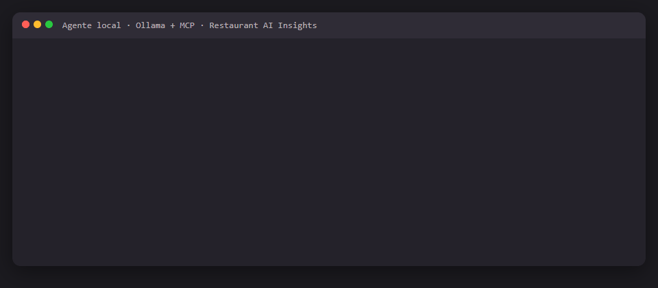

# MCP local

O servidor expõe duas ferramentas de consulta sobre promoções. Ele usa os mesmos modelos de
entrada e o mesmo motor Python da API web. As ferramentas calculam cenários sem chamar Ollama
e sem abrir uma porta de rede.

## Instalar e conectar

Com o ambiente virtual do [README](../README.md#como-executar) ativado, execute na raiz:

```bash
python -m pip install -r requirements-mcp.txt
python -m src.simulador.mcp_servidor
```

O processo aguarda um cliente MCP via stdio. Em um cliente que aceite configuração JSON no
formato `mcpServers`, aponte para o executável Python do ambiente e para a raiz do projeto.

```json
{
  "mcpServers": {
    "restaurant-ai-insights": {
      "command": "/caminho/restaurant-ai-insights/.venv/bin/python",
      "args": ["-m", "src.simulador.mcp_servidor"],
      "env": { "PYTHONPATH": "/caminho/restaurant-ai-insights" }
    }
  }
}
```

No Windows, use o caminho absoluto para `.venv/Scripts/python.exe`.

## Ferramentas

| Ferramenta | Parâmetro `hipotese` | Resultado |
| --- | --- | --- |
| `simular_promocao` | `base` e `promocional`, com todos os campos do simulador | Contribuição, comparação, meta e capacidade operacional. |
| `comparar_alternativas` | Os mesmos cenários, mais `desconto_menor_centavos`, `estacao` e `custo_adicional_centavos` | Pedidos prontos, contribuição, custo adicional e resultado após reforço. |
| `testar_desconto` | Só `desconto_reais` e, opcionalmente, `pedidos`; o resto vem do cenário inicial | Resumo compacto: se paga, meta de pedidos prontos, capacidade e diferença no turno. Feita para agentes e modelos pequenos. |

Os campos dos cenários são números JSON. Use reais para preços, descontos e custos dos cenários.
Os valores monetários dos resultados e os campos adicionais com sufixo `_centavos` são centavos
inteiros. A estação do reforço é `pessoas_preparo` ou `pessoas_embalagem`.

Para gerar os argumentos do caso demonstrado e colá-los em um cliente, execute:

```python
import json
from src.simulador.parametros import campos_para_interface

base = {campo["nome"]: campo["padrao"] for campo in campos_para_interface()}
hipotese = {
    "base": base,
    "promocional": {**base, "desconto": 5, "pedidos": 30},
    "desconto_menor_centavos": 300,
    "estacao": "pessoas_preparo",
    "custo_adicional_centavos": 2010,
}
print(json.dumps({"hipotese": hipotese}, indent=2))
```

O exemplo de `comparar_alternativas` retorna `29040` centavos após custos nas duas opções,
com 22 e 27 pedidos prontos. Para `simular_promocao`, passe apenas `base` e `promocional`
dentro de `hipotese`.

## Agente local



`scripts/agente_mcp.py` liga um modelo do Ollama ao servidor MCP: o modelo escolhe a ferramenta e os
argumentos, o motor calcula e a resposta final passa pela mesma checagem de números do assistente.

```bash
ollama pull qwen2.5:3b
python -m scripts.agente_mcp "Um desconto de R$ 5 se paga?"
```

- **Proteções:** se a resposta citar um número que não está na pergunta nem no resultado da ferramenta,
  ela é trocada por um texto montado com o resultado. Sem chamada de ferramenta, a resposta só passa se
  não tiver números novos.
- **Esquema simplificado:** o agente envia ao modelo só o tipo e a descrição de cada campo. Com o esquema
  completo do Pydantic (`anyOf`, `title`, `exclusiveMinimum`), o Ollama 0.40.18 devolvia resposta vazia.
  A validação completa continua no servidor.
- **Modelo:** por padrão o agente oferece só `testar_desconto` e usa o `qwen2.5:3b`. Em 25/11/2026, com
  três perguntas, o 3B fez a chamada certa em 3 de 3 em quatro variações de prompt e descrição; o 1.5B
  da interface acertou no máximo 1 de 3 e, sem ferramenta, inventou números (descartados).
  Depois, o fluxo completo com o 3B rodou duas vezes nas três perguntas: 6 de 6 chamadas certas e
  respostas aceitas pela checagem.
- **GIF:** montado linha a linha a partir da transcrição real em
  [`capturas/agente-mcp.json`](capturas/agente-mcp.json), com os tempos medidos nesta máquina.

## Verificar

```bash
python -m pytest -q tests/test_mcp.py
```

O teste inicia o servidor em um subprocesso, consulta o inventário e compara a resposta
estruturada das ferramentas com a API HTTP. Cenários inválidos retornam erro da ferramenta.
`tests/test_agente_mcp.py` simula o modelo e confere o esquema simplificado e as três proteções do agente.
