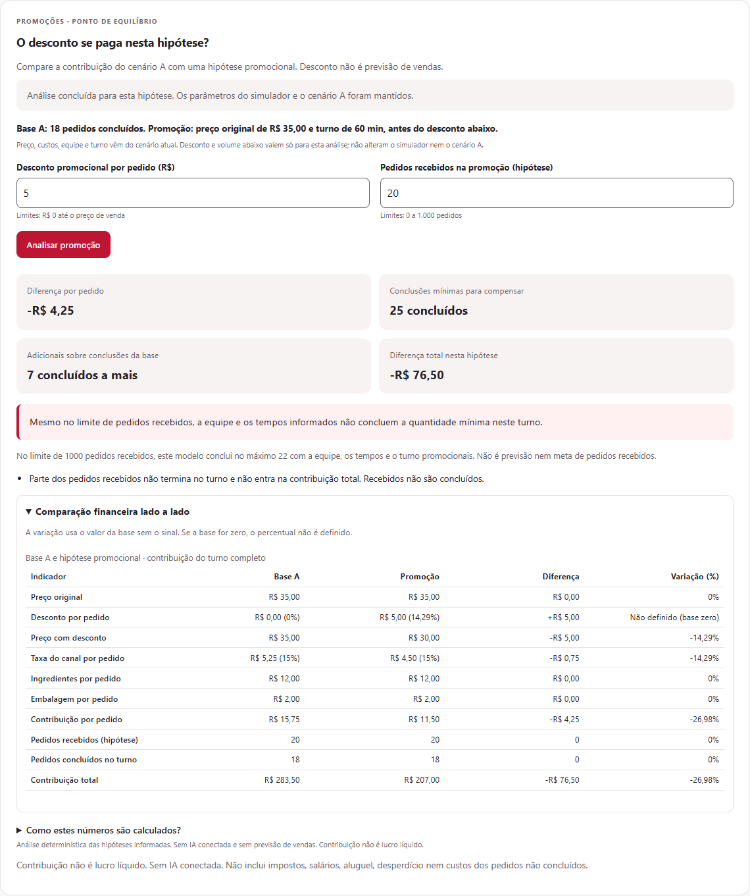

# RAI-008 — promoções e ponto de equilíbrio da contribuição

## Como usar

1. Em **Cenários**, guarde o cenário atual como A. Ele será a referência da análise.
2. Use **Simulador** para mudar preço, custos, equipe ou turno, se necessário. O A permanece guardado.
3. Volte a **Cenários** e abra **Analisar promoção**. Informe desconto em reais e uma hipótese de pedidos recebidos.
4. Clique em **Analisar promoção**. Confira diferença por pedido, diferença total, conclusões mínimas,
   pedidos adicionais sobre as conclusões da base e a limitação operacional.
5. Expanda a comparação financeira e as fórmulas para entender os números. No celular, a comparação
   começa recolhida. A hipótese local não modifica o simulador nem o A; recarregar descarta os dados.

Sem cenário A ou com o cenário atual inválido/desatualizado, não é possível analisar.
Alterar uma hipótese, atualizar/substituir/limpar cenários cancela a requisição anterior e oculta
os resultados que já não correspondem às entradas. Há feedback de espera, validação e falha com repetição.



[Ver captura no celular](capturas/promocao-mobile-rai-008.png).

## Fórmulas e convenções

Todas as decisões usam centavos inteiros. O financeiro e a operação existentes são reutilizados,
sem nova versão dos cálculos no JavaScript.

- Preço líquido = preço original − desconto.
- Desconto (%) = desconto ÷ preço original × 100.
- Taxa do canal = preço líquido × taxa (%), **arredondada por pedido ao centavo, meio para cima**.
- Contribuição unitária = preço líquido − taxa arredondada − ingredientes − embalagem.
- Contribuição total = contribuição unitária × **pedidos concluídos**.
- Diferença absoluta = promoção − base.
- Variação (%) = diferença ÷ **valor absoluto da base** × 100. Assim, o sinal indica aumento ou redução
  também para bases negativas; com base zero, retorna `null`. A convenção é explicada na interface.
  `Fraction` calcula o percentual; a conversão para `float` acontece apenas na saída, para exibição.

O problema de equilíbrio é **n × u ≥ B**, para inteiros n ≥ 0: u é a contribuição unitária
promocional, B é a contribuição total da base e n conta conclusões, não recebimentos.

| Condição | Solução matemática |
| --- | --- |
| B > 0 e u > 0 | Mínimo = teto(B ÷ u), calculado por divisão inteira |
| B > 0 e u ≤ 0 | Não existe volume que compense a base positiva |
| B ≤ 0 e u ≥ 0 | Mínimo = 0; qualquer quantidade mantém contribuição ≥ B |
| B ≤ 0 e u < 0 | Intervalo de 0 até piso(B ÷ u); vender mais pode deixar o total abaixo da base |

Adicionais sobre a base = máximo(0, mínimo − conclusões da base); `null` se não há solução.
O mínimo zero para base negativa **não** indica equilíbrio do negócio ou recomendação de parar
de operar. O máximo admissível, quando existe, é exibido separadamente e não é uma meta de crescimento.

## Limite operacional

Além de calcular a meta financeira, o servidor simula o maior volume de pedidos recebidos permitido
por `CAMPOS` (atualmente 1.000), com equipe, tempos e duração da hipótese promocional.

Esse resultado é um teto de conclusões **dentro deste modelo**: aumentando N, a chegada do k-ésimo
pedido uniforme, (k − 1) × turno/N para k começando em 1, não fica mais tarde. O primeiro chega
no minuto zero, como em `operacao.py`. As duas filas FIFO, tempos constantes e pessoas
fixas preservam a ordem e não atrasam a conclusão do k-ésimo pedido. Assim, aumentar recebimentos
não diminui o total concluído. Há teste dessa propriedade em diferentes configurações.

A meta pode ser financeiramente impossível, exceder o limite de recebimentos, exceder as conclusões
possíveis ou caber no modelo mas não na hipótese atual. A resposta distingue esses casos de uma
hipótese que já iguala/supera a base. Para margem negativa, uma hipótese pior que a base recebe
`limite_de_perda_excedido`, nunca uma sugestão de aumentar o volume.

Não se converte o mínimo de conclusões em promessa de pedidos recebidos. A demanda é sempre uma
hipótese, não um efeito atribuído ao desconto. Mudanças de outros parâmetros e turnos diferentes
geram avisos: a diferença pode não decorrer apenas da promoção.

## Exemplo conferido

Cenário padrão: preço R$ 35, ingredientes R$ 12, embalagem R$ 2 e taxa 15%.
Com 20 pedidos recebidos, 18 são concluídos: contribuição unitária R$ 15,75 e total R$ 283,50.

Desconto de R$ 5, mantendo demanda e operação: taxa por pedido R$ 4,50, contribuição unitária
R$ 11,50, total R$ 207,00. Diferenças: −R$ 4,25 por pedido e −R$ 76,50 no turno (−26,98%).
São necessárias **25 conclusões**, 7 além das 18 da base. Porém, mesmo recebendo 1.000 pedidos,
essa operação conclui no máximo **22** no turno. A meta não cabe nessa configuração operacional.

## Contrato novo, anteriores preservados

`POST /api/promocoes` recebe `{"base": {...}, "promocional": {...}}`. Cada objeto tem os mesmos
campos, limites e validações de `POST /api/simulacoes`. Não aceita propriedades extras ou números
como texto. Erros usam o envelope existente `{"erros": {...}}`, com nomes qualificados como
`promocional.desconto` e `base.pedidos`.

A resposta contém `base`, `promocional`, `diferencas`, `equilibrio`, `alertas`, `formulas` e
`identificacao`. Valores terminados em `_centavos` são inteiros, e não inclui a lista de eventos.
Nenhum endpoint anterior ganhou campos ou mudou de comportamento.

## Verificação reproduzível

Com o servidor da branch na porta 8020, Chrome instalado e as ferramentas opcionais da revisão RAI-007:

```powershell
.\.venv\Scripts\python.exe -m uvicorn src.simulador.api:app --host 127.0.0.1 --port 8020
```

Em outro terminal:

```powershell
.\.venv\Scripts\python.exe -m pytest
node --test "tests/js/*.test.mjs"
$env:NODE_PATH = "$PWD/.tmp-ui/node_modules"
node tests/browser/promocoes.cjs
```

Instalação opcional, se ainda não existir: `npm install --prefix .tmp-ui --no-package-lock --no-save playwright@1.58.2 @axe-core/playwright@4.11.1`.
`RAI_URL` muda o endereço do servidor; `RAI_SO_FLUXOS=1` pula apenas a matriz visual.
O roteiro anterior `tests/browser/interface.cjs` verifica os fluxos da RAI-007; aponte `RAI_URL`
para o mesmo servidor para verificar compatibilidade. As capturas do teste ficam em `tmp/`.

## Limitações

Revisão técnica de 2026-11-06: novas execuções de **225 testes Python e 104 JavaScript**,
24 combinações de promoções e 72 das seis áreas anteriores no Chrome, sem falhas detectadas.
Escopo, comandos, correção documental e restrição da reinstalação de dependências estão em
[`revisao-rai-008.md`](revisao-rai-008.md). Os resultados históricos abaixo são de outra execução.

Validação do código `d70c28c` em clone limpo: **225 testes Python, 104 JavaScript**, `pip check`
sem erros. Chrome: 24 combinações de largura/tema/sinal da margem, sem estouro ou violações
detectadas pelo axe. Fluxos novos e anteriores aprovados também contra o servidor desse clone.
Entrega em revisão no [PR #10](https://github.com/GabrieliModollo/restaurant-ai-insights/pull/10).

- É equilíbrio da **contribuição entre cenários**, não o ponto de equilíbrio completo da empresa.
- Impostos, salários, aluguel, desperdício e custos de pedidos não concluídos continuam excluídos.
- Mesmo modelo de um produto, chegadas uniformes, tempos fixos, sem cancelamentos, pausas ou desistências.
- Sem LLM, previsão de vendas ou decisão automática sobre a melhor estratégia.
- Chrome sem janela com tamanhos e temas emulados não equivale a aparelho físico, toque ou leitor de tela.
  Usabilidade com pessoas reais e validação em outros navegadores continuam pendentes.
